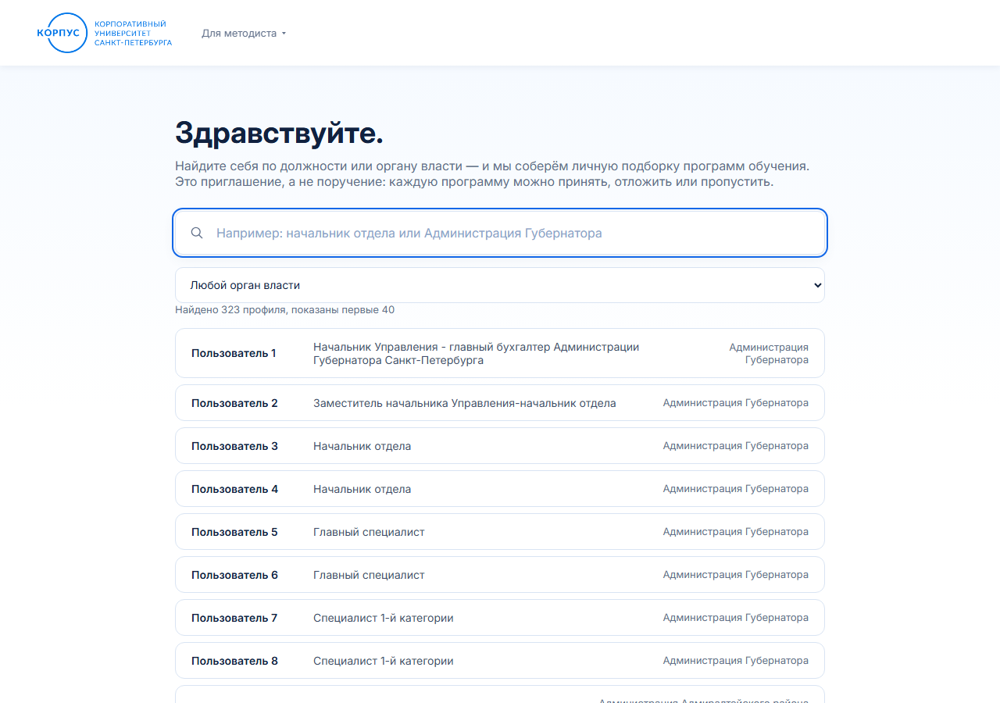
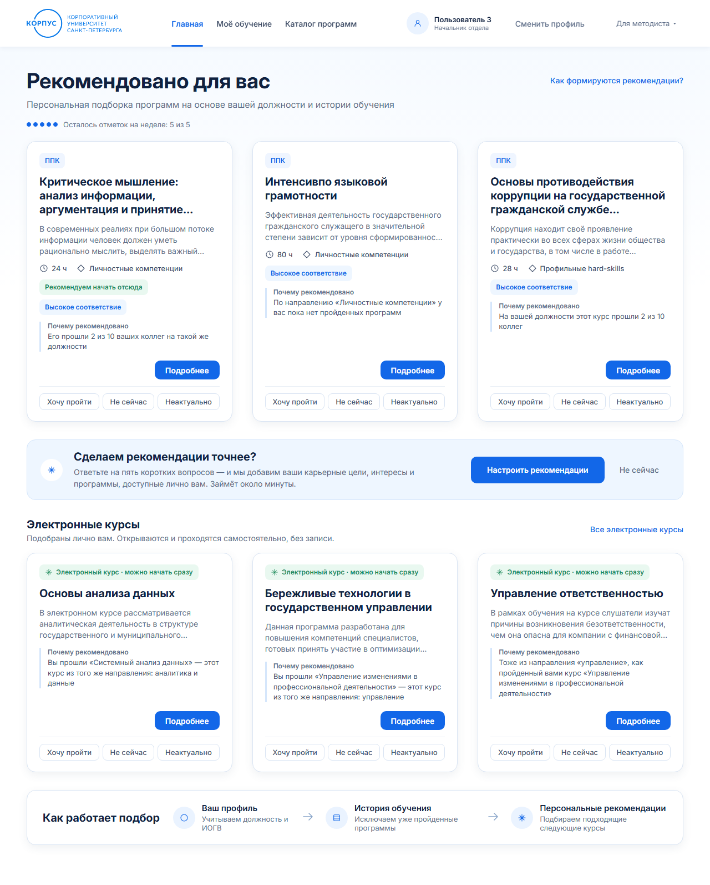
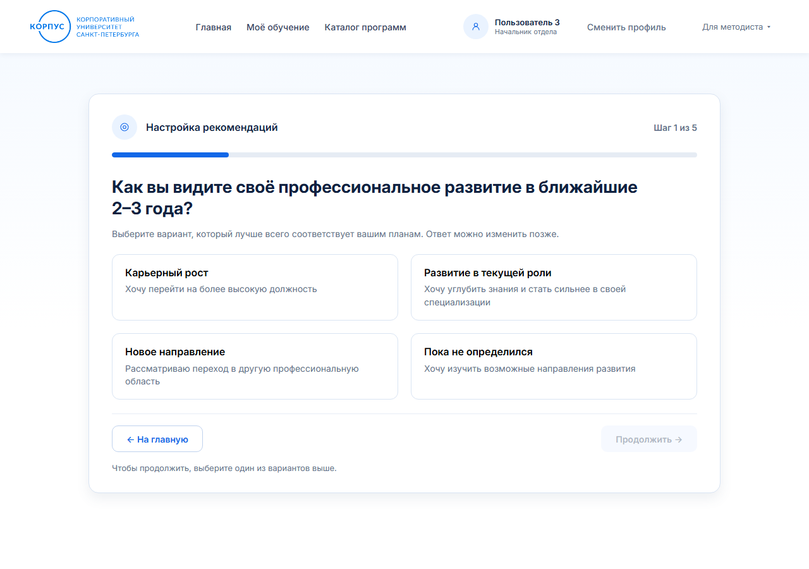
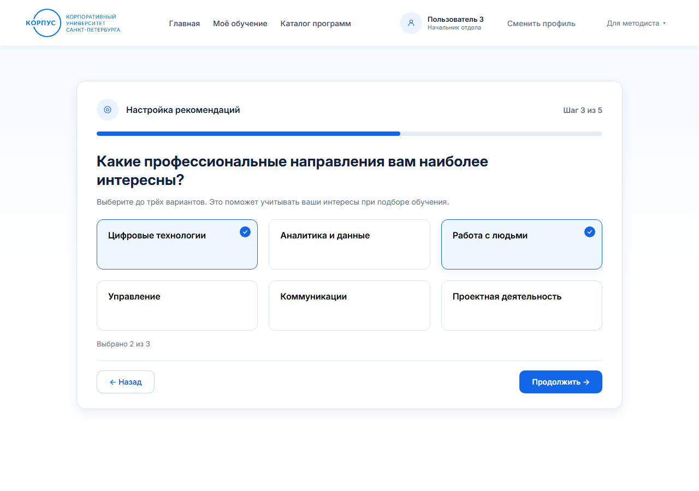
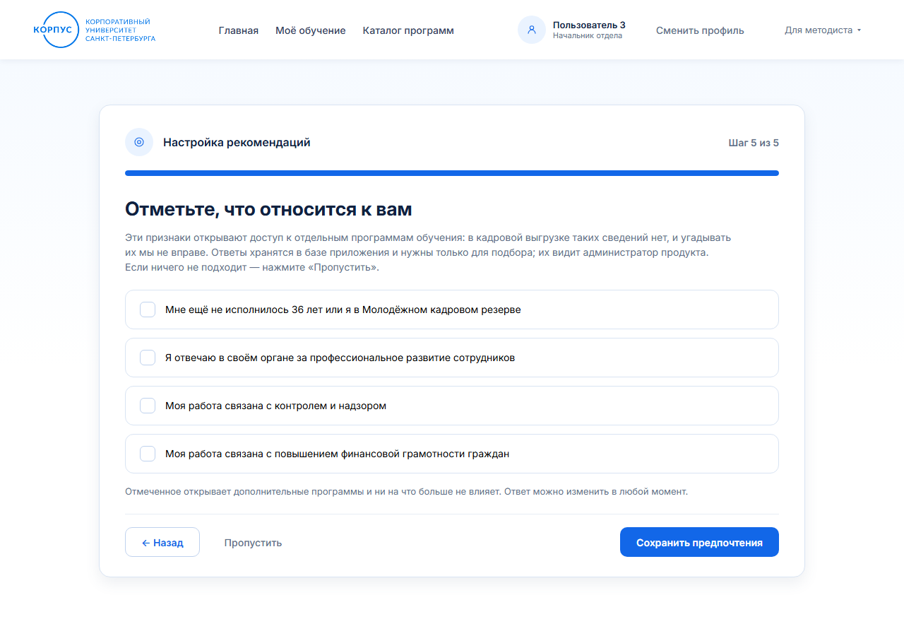
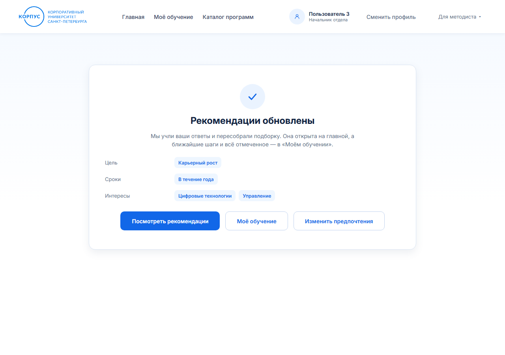
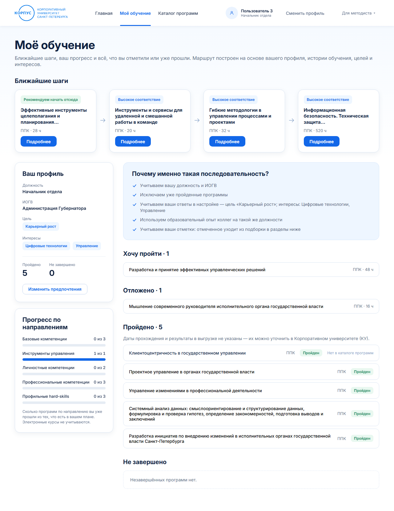
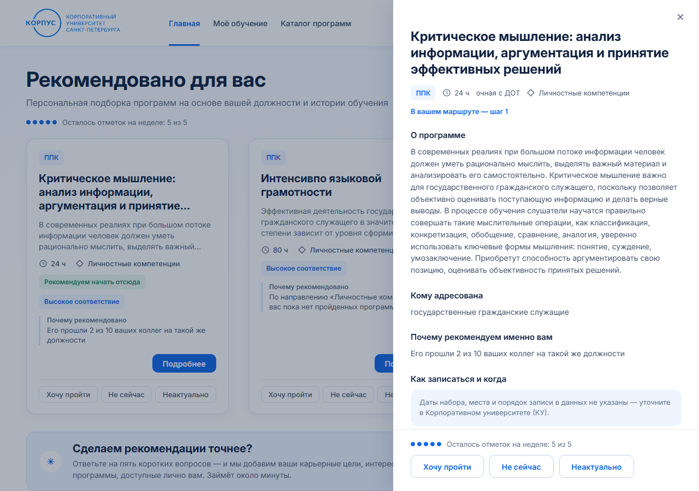
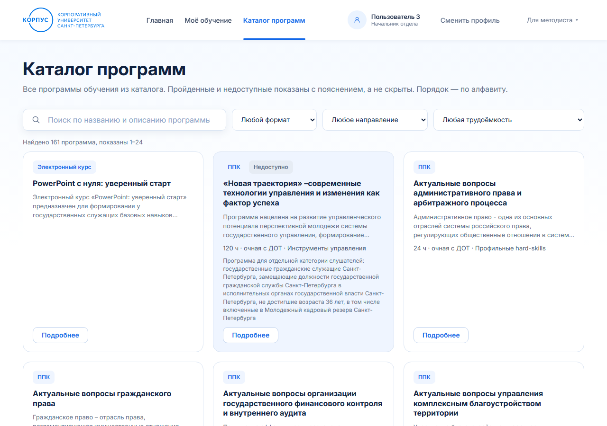

# Мой путь развития — как пользоваться

Продукт подбирает вам личную подборку программ обучения 2025 года: что пройти
дальше, исходя из должности, уже пройденного обучения и того, что проходят
коллеги на такой же должности.

**Все программы бесплатны.** Подборка — это приглашение, а не поручение.
Ничего не происходит без вашего решения.

---

## С чего начинается работа

### Экран выбора: найдите себя

Начните вводить должность или орган власти — список сузится. Найдя себя,
нажмите на строку.

Выбор запоминается: в следующий раз продукт откроется сразу на вашей подборке.
Сменить профиль можно в любой момент кнопкой справа вверху.

---

## Главная: рекомендовано для вас

Три программы, наиболее подходящие вам сейчас. На каждой карточке:

- **формат** — ППК (программа повышения квалификации) или электронный курс;
- **трудоёмкость и направление**, если они указаны в каталоге;
- **метки**: «Рекомендуем начать отсюда» стоит на первом шаге маршрута,
  «Высокое соответствие» — когда за программу говорит сразу несколько причин;
- **«Почему рекомендовано»** — одно короткое предложение, всегда на виду. Оно
  говорит только то, что есть в данных: какой пройденный вами курс эта
  программа продолжает, сколько коллег на вашей должности её проходили, что
  совпало с вашей целью или интересом. Если мы пока вас не знаем (нет ни
  истории обучения, ни ответов на вопросы), так и сказано: «Мы пока с вами не
  знакомы, но этот курс чаще всего полезен на вашей должности».

### Три действия под каждой программой

- **Хочу пройти** — программа уходит из подборки в раздел «Моё обучение» →
  «Хочу пройти»;
- **Не сейчас** — отложить: программа ждёт в разделе «Отложено»;
- **Неактуально** — убрать из планов: программа лежит в «Скрытых мной», оттуда
  её можно вернуть.

Нажатие ничего не запускает и никого не уведомляет: заявка на обучение так не
подаётся, руководителю ничего не уходит.

Отмеченная карточка **сразу заменяется следующей по рейтингу** — ждать и
нажимать «обновить» не нужно. Отметки сохраняются и после закрытия браузера.

### Пять отметок в неделю

Отметка — это решение о программе, поэтому их пять на неделю на человека.
Счётчик «Осталось отметок на неделе: 3 из 5» стоит под заголовком. Отсчёт
начинается с первой отметки; когда они закончились, кнопки гаснут, а сообщение
говорит, когда откроются новые («Новые отметки откроются через 5 дн. 3 ч»).
Снять уже поставленную отметку можно всегда — она не тратит и не возвращает
запас.

### Электронные курсы

Ниже программ — ряд **электронных курсов**, подобранных лично вам: их проходили
коллеги на вашей должности или из вашего органа власти, они близки к тому, что
вы уже прошли, или совпали с вашими интересами. Их не нужно согласовывать и на
них не записываются: открыл и прошёл. Курсы без личного основания в подборку не
попадают — все они есть в «Каталоге программ» (ссылка «Все электронные курсы»).
У них часто не указаны часы — это не ошибка, таких сведений нет в реестре.

---

## Настройка рекомендаций: пять коротких вопросов

Подборка строится и без этого — по должности и истории обучения. Пять вопросов
делают её точнее: продукт узнаёт то, чего нет ни в одной кадровой выгрузке.

Занимает около минуты. Ответы можно изменить в любой момент.

### Шаг 1 — как вы видите своё развитие

### Шаг 2 — период планового повышения квалификации

Влияет на то, какие программы окажутся в начале подборки: при сжатых сроках
вперёд выходят короткие и дистанционные.

### Шаг 3 — какие направления интересны

До трёх вариантов. Когда выбрано три, остальные становятся неактивными —
снимите одну отметку, чтобы поставить другую.

### Шаг 4 — какие программы интересны

Продукт предварительно отберёт несколько программ. Отметьте те, что цепляют.

### Шаг 5 — что относится к вам

Здесь спрашивается то, чего нет в кадровой выгрузке: возраст до 36 лет или
участие в Молодёжном кадровом резерве, ответственность за профессиональное
развитие в вашем органе, работа, связанная с контролем и надзором или с
финансовой грамотностью граждан.

**Отмечать ничего не обязательно.** Отметка открывает дополнительные
программы, доступные вашей категории, и ни на что больше не влияет.

### Готово

Экран покажет, что именно записано. Если что-то не так — «Изменить
предпочтения» откроет мастер с вашими ответами, вводить заново ничего не нужно.

---

## Моё обучение

Один экран про вас и ваше обучение. Наверху — **ближайшие шаги**: четыре
программы, с которых стоит начать, по порядку. Наведите курсор на программу —
покажется краткое описание; «Подробнее» открывает полную карточку.

Слева — ваш профиль и **прогресс по направлениям**: «1 из 3» значит, что вы
прошли одну программу из трёх, которые есть в вашем плане по этому направлению.
Электронные курсы здесь не учитываются — у них нет направления.

Справа — «Почему именно такая последовательность» (что учитывалось при подборе)
и то, что вы решили про программы:

- **Хочу пройти**, **Отложено** — ваши отметки;
- **Пройдено** и **Не завершено** — история обучения из выгрузки;
- **Скрытые мной** — программы, отмеченные «неактуальными»; кнопка «Вернуть»
  возвращает программу в подборку.

Записи, которых нет в каталоге 2025 года, помечены: программа была пройдена
раньше, а в нынешнем каталоге её нет. Старый адрес «Моя траектория» по-прежнему
открывается и ведёт на этот же экран.

---

## Карточка программы

Полное описание: о программе, цель, чему научитесь, кому адресована и почему
рекомендована именно вам. Внизу — те же три действия.

Закрыть можно крестиком, щелчком мимо панели или клавишей Esc.

---

## Каталог программ

Все программы 2025 года, а не только рекомендованные. Поиск по названию и
фильтры: формат, направление, трудоёмкость.

Программы, которые вам сейчас недоступны, **не скрыты**, а помечены с
объяснением причины. Часть из них открывается, если отметить что-то о себе на
пятом шаге мастера.

Уже пройденные помечены «Пройдено».

---

## Если что-то не работает

**«Сервер не отвечает».** Закрыто окно запуска (`START.bat` или `start.sh`).
Откройте его снова.

**Подборка не изменилась после мастера.** Нажмите «Изменить предпочтения» и
убедитесь, что ответы сохранены. Если пусто — пройдите мастер ещё раз.

**«Пока недостаточно данных».** После отбора осталось слишком мало программ,
чтобы собрать подборку. Пройдите мастер — этого обычно достаточно.

**Кнопки отметок серые.** Закончились пять отметок этой недели; под заголовком
написано, когда откроются новые.

---

## Что стоит знать

**Продукт никогда не предложит то, что вы уже прошли** — даже если программа
записана в вашей истории под другим форматом.

**Недоступные вашей категории программы не попадают в подборку.** В каталоге
они видны, но с пояснением.

**Языковая модель может переупорядочить подборку и написать текст, но не может
добавить программу.** Всё, что она предложит сверх отобранного, отбрасывается.
Если модель недоступна, подборка строится всё равно — вы этого не заметите.

**Порядок программ не меняется сам по себе** между открытиями.
